# 手机 BLE-MIDI ↔ ESP32-S3 ↔ USB-MIDI 控制器设计

- 日期：2026-10-20
- 状态：待批准
- 仓库：`remoteesp32midi`
- 首期平台：Windows 11 + Android；iOS 后续复用共享层

## 1. 意图

把手机做成一块可自由配置的 MIDI 控制面板：

```
手机 App（Compose Multiplatform + Backdrop）
        │  BLE：标准 BLE-MIDI
        ▼
ESP32-S3（BLE 外设 + USB-MIDI 设备）
        │  USB：标准 USB-MIDI，免驱
        ▼
电脑（Windows 11 + Ableton Live 12）
```

手机负责控件、布局和 MIDI 映射；ESP32-S3 负责把 BLE-MIDI 原样桥接到 USB-MIDI，并把电脑发回的 MIDI 原样桥接回手机。这样换控件、换通道、换编号都不需要重新烧固件。

## 2. 目标

- ESP32-S3 通过原生 USB 口被 Windows 识别为标准 USB-MIDI 设备，Ableton Live 12 能看到输入/输出端口。
- ESP32-S3 作为 BLE 外设，提供标准 BLE-MIDI GATT 服务；手机可扫描、连接、断线重连。
- Android App 可添加按钮、旋钮和推子，为每个控件设置 MIDI 类型、通道、编号。
- 按钮按下/松开发送 Note On/Off 或 CC 127/0；旋钮和推子发送 14-bit CC（0–16383），连续转动/拖动流畅。
- BLE 延迟尽量低：优先 7.5–15 ms 连接间隔、2M PHY、Write Without Response；固件内部 BLE→USB p95 目标 < 5 ms。
- 电脑发回的 MIDI 经 BLE 通知回手机，App 按“类型 + 通道 + 编号”更新对应控件显示。
- 控件配置和布局保存在手机本地，重启 App 后恢复。
- 连接后 App 可退到后台/息屏，由 Android 前台服务保持 BLE 连接。
- 共享层保持平台无关，后续 iOS 只补 BLE 传输和文件存储实现。

## 3. 非目标

- 首期不做 iOS App；只保证架构不堵死。
- 不做 DIN MIDI、USB Host、Wi-Fi、云端同步、账号系统。
- 固件不保存控件表，不做控件 ID 到 MIDI 的映射；映射全部在 App 端。
- 首期不做 SysEx 编辑/转发、不做多页布局、不做拖拽排序。
- 首期不做 Knob/Fader + Note；连续控件只发 CC。
- 首期不通过自定义 GATT 回报电脑 USB 挂载状态；`Ready` 只表示 BLE 已连接且通知已订阅。
- 首期不做开机自启、账号、云同步、多设备并行连接。
- 不实现 Ableton 专用 Control Surface 脚本；只用标准 MIDI 端口和手动 MIDI 映射。

## 4. 已确认决策

| 项目 | 决策 | 说明 |
|---|---|---|
| 固件框架 | ESP-IDF 5.5.x | TinyUSB；BLE 优先用 `espressif/ble_midi` 组件，失败则回退 NimBLE 自写 GATT |
| 手机端 | Kotlin Multiplatform + Compose Multiplatform | Android 先做；共享 UI/状态/协议；BLE 用平台实现 |
| UI 库 | Backdrop 2.0.1 | 液态玻璃；库本身不含高层组件，按钮/旋钮/推子需自己封装 |
| BLE 方案 | 标准 BLE-MIDI + App 端映射 | 固件是无状态桥；App 编码已经带通道/编号的 MIDI |
| 控件 | 按钮、旋钮、推子 | 按钮 Note 或 CC；旋钮/推子 14-bit CC |
| 后台连接 | Android 前台服务 | 息屏/后台保持 BLE；通知栏可断开 |
| 布局 | 单页 2 列网格 | 按添加顺序排列；首期不做多页/拖拽 |
| 验收 DAW | Ableton Live 12 Suite | Windows 11；MIDI 端口输入/输出都启用 Remote |
| 电脑 | Windows 11 | 当前串口 `COM5` 是 CH340 UART，不是原生 USB |

## 5. 系统架构

```mermaid
flowchart LR
    subgraph Phone["Android App (KMP)"]
        UI["Compose UI + Backdrop"]
        STORE["ControllerStore"]
        MAP["MidiMapper"]
        CODEC["BLE-MIDI Codec"]
        SERVICE["Foreground Service + Send Queue"]
        BLE["BleTransport (Android)"]
        UI --> STORE --> MAP --> CODEC --> SERVICE --> BLE
        BLE --> CODEC --> MAP --> STORE --> UI
    end

    subgraph ESP["ESP32-S3"]
        GATT["BLE-MIDI GATT (component / fallback)"]
        BPARSE["BLE-MIDI Parser/Encoder"]
        BRIDGE["MIDI Bridge Queues"]
        USB["TinyUSB MIDI Device"]
        GATT --> BPARSE --> BRIDGE --> USB
        USB --> BRIDGE --> BPARSE --> GATT
    end

    subgraph PC["Windows 11"]
        DRV["USB-MIDI Class Driver"]
        LIVE["Ableton Live 12"]
        DRV --> LIVE --> DRV
    end

    BLE <-- "BLE-MIDI write / notify" --> GATT
    USB <-- "USB-MIDI IN/OUT" --> DRV
```



### 5.1 数据流

正向：

1. 用户操作按钮/旋钮/推子。
2. `ControllerStore` 更新本地值，生成 `MidiMessage(type, channel, number, value)`；连续控件生成 MSB+LSB 两条 CC。
3. `MidiMapper` 确认控件映射；`BleMidiCodec` 编码为标准 BLE-MIDI 包；14-bit CC 对放在同一个通知里。
4. 前台服务把包放入发送队列，Android `BluetoothGatt` 以 Write Without Response 写入 ESP32 的 BLE-MIDI 特征。
5. ESP32 解析 BLE-MIDI，转成 USB-MIDI 事件包，从 USB IN 端点发给电脑。
6. Ableton 收到对应通道的 Note/CC。

反向：

1. Ableton 通过 USB OUT 端点发送 MIDI。
2. ESP32 读取 USB-MIDI 事件包，编码为 BLE-MIDI 通知。
3. 手机收到通知，`BleMidiCodec` 解码，`MidiMapper` 按 `(类型, 通道, 编号)` 找到控件并更新值。
4. UI 刷新；**不因回传再次发送 MIDI**，避免回环。

### 5.2 为什么固件做无状态桥

- 控件表只在 App 内，添加控件、改通道/编号不需要重烧固件。
- 不存在“手机配置与固件配置不一致”的状态同步问题。
- 标准 BLE-MIDI 可被第三方 BLE-MIDI 工具直接测试。
- 断线重连后，App 重发当前控件值即可恢复 DAW 状态。
- 代价：固件不提供“脱离手机仍按控件表工作”的能力；当前需求不需要。

## 6. BLE-MIDI 约定

### 6.1 UUID 与特征

- Service UUID：`03B80E5A-EDE8-4B33-A751-6CE34EC4C700`
- Characteristic UUID：`7772E5DB-3868-4112-A1A9-F2669D106BF3`
- 属性：`WRITE WITHOUT RESPONSE` + `NOTIFY`
- 手机 → ESP32：写特征
- ESP32 → 手机：通知特征
- CCCD 必须支持使能/关闭通知

### 6.2 广播与连接参数

- 设备名：`ESP32-S3 MIDI`
- 广播包含 Service UUID，手机按 Service UUID 过滤扫描。
- 可连接、非定向广播；断开后自动重新广播。
- 固件优先使用 Espressif `espressif/ble_midi` 组件（0.1.0~2）实现 GATT/BEP；该组件已包含上述 Service/Characteristic、Write Without Response + Notify、多消息聚合、SysEx/实时消息和低延迟连接参数。若与 ESP-IDF 5.5.2/S3 不兼容，回退到自写 NimBLE GATT + 编解码。
- 手机连接后请求 MTU 247；组件默认 185 也可接受；默认 23 也要能工作（单条 14-bit CC 对约 10 字节）。
- 手机请求高优先级连接（Android `requestConnectionPriority(CONNECTION_PRIORITY_HIGH)`）；目标连接间隔 7.5–15 ms，slave latency 0；组件侧也请求 7.5 ms/0/4 s。
- 首期不做配对/绑定；服务开放。风险是附近设备可发送 MIDI；后续可加 bonding。

### 6.3 包格式

标准 BLE-MIDI：

- 包级 Header：`bit7=1`、`bit6=0`、低 6 位为 13 位时间戳的高 6 位。
- 每条消息前有一个 per-message timestamp 字节：`bit7=1`、低 7 位为时间戳低 7 位；同一包内多条消息各自带 timestamp。
- 消息本身是完整 MIDI（status + data）或 running status；running status 只在同一包内有效。

编码器总是带完整 status；单条消息（按钮/Note）可以单独成包，14-bit CC 的 MSB+LSB 放在同一个包内。解码器必须兼容 running status、多消息包和 per-message timestamp。

示例（时间戳 0）：

| 动作 | BLE-MIDI 十六进制 |
|---|---|
| Note On，通道 1，C4，力度 127 | `80 80 90 3C 7F` |
| Note Off，通道 1，C4 | `80 80 80 3C 00` |
| CC，通道 1，CC1，值 64 | `80 80 B0 01 40` |
| 14-bit CC，通道 1，CC1/2 = 8192 | `80 80 B0 01 40 80 B0 02 00` |
| Pitch Bend，通道 1，中心 | `80 80 E0 00 40` |

时间戳取单调毫秒的低 13 位；回绕按 13 位处理。USB 侧不需要时间戳，收到即发送。

### 6.4 首期消息范围

- 支持通道语音消息：Note Off、Note On、Poly Pressure、CC、Program Change、Channel Pressure、Pitch Bend。
- App 首期生成：Note On/Off、7-bit CC（Button+CC）、14-bit CC（Knob/Fader）。
- SysEx、实时消息（Clock/Start/Stop 等）首期不转发；解码时丢弃并计数，避免崩溃。
- 所有非法/截断包丢弃并记录计数，不阻塞后续数据。

### 6.5 低延迟策略

目标：手机操作到 Ableton 收到 MIDI 的端到端延迟尽量低；固件内部 BLE 写入回调到 USB 写入完成的目标 p95 < 5 ms，整条链路目标 < 20 ms（受手机 BLE 栈和 DAW 影响，不承诺固定值）。

- 连接参数：请求 7.5–15 ms 连接间隔、slave latency 0、supervision timeout 2–4 s；ESP32 端设置 preferred connection parameters，手机端 `requestConnectionPriority(CONNECTION_PRIORITY_HIGH)`。
- 物理层：ESP32-S3 与手机都支持时使用 LE 2M PHY；同时启用 Data Length Extension。手机端调用 `setPreferredPhy(TX_PHY_LE_2M_MASK, RX_PHY_LE_2M_MASK, ...)`，失败则回退 1M PHY。
- MTU：请求 247；单条 14-bit CC 对约 10 字节，默认 23 也够，但更大的 MTU 可减少多消息打包时的分包。
- ESP32 关闭 BLE modem sleep（USB 供电，不追求低功耗）；提高 BLE host/bridge 任务优先级；热路径不打 UART 日志。
- 手机使用 Write Without Response + Notify；14-bit CC 的 MSB/LSB 放在同一个通知里；按钮事件立即发送，不等待采样窗口。
- 手机连续控件按 100 Hz 采样，取窗口内最新值；拖动结束强制发送最终值。发送队列积压时合并连续控件的中间值，保持低延迟；不合并 Note/按钮事件。
- USB 侧收到即写，不做时间戳对齐/缓冲；USB FS 帧 1 ms，正常不会成为瓶颈。
- 验收时记录固件时间戳差值和发送队列深度；若手机实际连接间隔被系统抬高，记录实际值并接受 15/30 ms 回退。

## 7. USB-MIDI 约定

- 使用 ESP-IDF 自带 TinyUSB MIDI device 类，单 virtual cable。
- 标准 USB-MIDI 1.0 事件包，4 字节；Cable Number 0。
- 电脑侧免驱；Windows 11 识别为 MIDI 设备。
- 原型 VID/PID：`0x303A / 0x4008`（来自 ESP-IDF 示例）。量产物需使用合法 VID/PID，首期不处理。
- **不做 CDC 复合设备**：USB 口只暴露 MIDI，减少复合设备兼容问题；调试日志走 UART0/COM5。
- 产品字符串：`ESP32-S3 MIDI Bridge`。
- 设备必须支持电脑 → ESP32 的 OUT 端点，否则无法回传。

USB-MIDI 事件包示例：

| 动作 | USB-MIDI 四字节 |
|---|---|
| Note On，通道 1，C4，力度 127 | `09 90 3C 7F` |
| Note Off，通道 1，C4 | `08 80 3C 00` |
| CC，通道 1，CC1，值 64 | `0B B0 01 40` |

## 8. 固件设计

### 8.1 工程结构

```
firmware/
  CMakeLists.txt
  sdkconfig.defaults
  idf_component.yml
  main/
    CMakeLists.txt
    main.c
    usb_midi.c / usb_midi.h
    ble_link.c / ble_link.h       # 封装 espressif/ble_midi + ble_conn_mgr
    midi_bridge.c / midi_bridge.h
    ble_midi_codec.c / ble_midi_codec.h  # 仅回退方案使用
```

`idf_component.yml`：

```yaml
dependencies:
  espressif/ble_midi: "0.1.0~2"
```

组件会拉取 `ble_conn_mgr`，并实现 BLE-MIDI GATT、BEP 编解码、多消息聚合、SysEx/实时消息。若组件在 ESP-IDF 5.5.2/S3 上构建或运行不通过，再回退到自写 NimBLE GATT + `ble_midi_codec`。

### 8.2 任务与缓冲

- `usb_task`：TinyUSB 设备任务；轮询/读取 USB MIDI OUT 数据，写入 `usb_to_ble` 队列；从 `ble_to_usb` 队列取数据写 USB IN。
- `ble_task`：通过 `esp_ble_midi_register_event_cb()` 接收已解析 MIDI 消息，复制进 `ble_to_usb` 队列；从 `usb_to_ble` 队列取消息，调用 `esp_ble_midi_send_multi()`（或 `esp_ble_midi_send_raw_midi()`）发送通知。
- `bridge_task`：如果使用回退方案，则解析 BLE-MIDI 字节流 → USB-MIDI 事件；使用组件时该任务只负责队列搬运/统计。
- 组件回调运行在 BLE host task；回调中只复制消息/入队，不解析、不阻塞、不打印长日志。
- 任务优先级：`usb_task` > `bridge_task` > `ble_task`，避免 USB 写入被 BLE 日志/扫描拖慢。
- 关闭 BLE modem sleep；USB 供电，优先低延迟而非省电。
- 队列深度 256 条；溢出计数并通过 UART 日志报告。100 Hz × 14-bit CC = 200 条 CC/秒，仍远低于 BLE 吞吐上限。
- 下行（USB → BLE）允许多条 MIDI 消息聚合到一个 BLE-MIDI 通知；使用 `esp_ble_midi_send_multi()`，每条消息各自带时间戳，按 MTU 自动分包。
- 下行队列满时，优先丢弃最旧的 CC/Pitch Bend/Channel Pressure/Poly Pressure（状态类消息，App 可只保留最新值），**不丢 Note On/Off/Program Change**；每次丢弃计数并在 UART 日志报告。
- 上行（BLE → USB）队列满时反压 BLE 写回调：只保留字节流，不解析；若无法反压则断开连接并重连，避免静默丢 Note Off。
- 在 BLE 写回调记录 `esp_timer` 时间戳，USB 写入完成后记录差值；维护 p50/p95/max 计数，供阶段 3/4 低延迟验收读取。

### 8.3 连接与重连

- 上电初始化 NVS、USB、`ble_conn_mgr`、`esp_ble_midi_profile_init()`、GATT 服务、bridge。
- 配置设备名、MTU（185/247）、连接间隔 7.5–15 ms、latency 0；广播包含 BLE-MIDI Service UUID。
- 连接后停止广播；断开回调里触发重广播，并执行 stuck note 保护。
- 不保存 bond；手机每次重新连接后重新订阅通知。
- 手机在 `Ready` 后重发当前 CC 值，恢复 DAW 侧状态。
- 组件初始化顺序：`esp_ble_conn_init()` → `esp_ble_midi_svc_init()` → `esp_ble_midi_profile_init()` → 注册回调 → `esp_ble_conn_start()`；以组件示例为准。
- **Stuck note 保护**：BLE 断开时，固件向 USB MIDI 发送所有 16 通道的 All Sound Off（CC 120）和 All Notes Off（CC 123）；USB 挂载/重新挂载后也发送一次。该操作仍然无状态，不依赖控件表。
- App 在连接断开时清空按钮按下态，避免 UI 残留高亮；重连后以 DAW 回传或本地当前值为准。

### 8.4 日志与状态

- UART0 日志，115200；通过 CH340 `COM5` 查看。
- 记录：USB 挂载/卸载、BLE 连接/断开、MTU、队列溢出、非法包计数。
- 首期不依赖板载 LED；如板子有 RGB LED，可在阶段 3 加连接状态指示，非验收项。

### 8.5 构建与烧录

```bash
idf.py set-target esp32s3
idf.py add-dependency "espressif/ble_midi=0.1.0~2"
idf.py build
idf.py -p COM5 flash monitor
```

- 烧录/日志用 UART 口（COM5）。
- USB-MIDI 必须把 S3 的**原生 USB 口**接到电脑；多数开发板有两个 USB-C，标着 `UART` 和 `USB`。
- 首次构建会从 ESP Component Registry 拉取 `ble_midi` 和 `ble_conn_mgr`；需要网络。
- 若组件构建失败，先确认 IDF 5.5.2 与目标 S3，再按设计回退自写 BLE 层；不要同时启用两套 BLE 栈。

## 9. App 设计

### 9.1 工程结构

首期只建 Android target，`commonMain` 保持平台无关；iOS target 后续在 macOS 上补。

```
app/
  settings.gradle.kts
  build.gradle.kts
  gradle/libs.versions.toml
  composeApp/
    src/commonMain/kotlin/.../
      model/Control.kt
      model/MidiMessage.kt
      model/Layout.kt
      midi/BleMidiCodec.kt
      midi/MidiMapper.kt
      ble/BleMidiTransport.kt
      store/ControllerStore.kt
      storage/LayoutStore.kt
      ui/...
    src/androidMain/kotlin/.../
      ble/AndroidBleMidiTransport.kt
      storage/AndroidLayoutStore.kt
      MainActivity.kt
```

### 9.2 依赖与版本

以 Backdrop 2.0.1 的发布元数据为准：

- Kotlin `2.4.10`
- Compose Multiplatform `1.12.0`
- Backdrop `io.github.kyant0:backdrop:2.0.1`
- Kyant Shapes `io.github.kyant0:shapes:1.2.1`
- AGP `9.3.2`
- Gradle wrapper 使用与 AGP 9.3.2 兼容的 9.x 版本
- Android `compileSdk 37`、`minSdk 26`；当前 SDK 只有 36，需要安装 platform 37
- `kotlinx-coroutines`、`kotlinx-serialization-json`、`kotlinx-datetime`
- `androidx.core:core-ktx`、`androidx.activity:activity-compose`（前台服务通知、权限请求）
- 不使用 Kable；BLE 直接用 Android `BluetoothGatt`，iOS 后续用 CoreBluetooth/CoreMIDI

### 9.3 领域模型

```kotlin
enum class ControlKind { BUTTON, KNOB, FADER }

enum class MidiType { NOTE, CC }

enum class MidiResolution { SEVEN_BIT, FOURTEEN_BIT }

data class MidiMapping(
    val type: MidiType,
    val channel: Int,                 // UI 1..16，线上 0..15
    val number: Int,                  // Note 编号或 CC 的 MSB 编号；7-bit 0..127，14-bit 0..126
    val resolution: MidiResolution     // 按钮 Note/CC 为 7-bit；旋钮/推子 CC 为 14-bit
)

data class Control(
    val id: String,
    val label: String,
    val kind: ControlKind,
    val mapping: MidiMapping,
    val value: Int = 0                 // 按钮 0/127；旋钮/推子 0..16383
)

data class Layout(
    val schemaVersion: Int = 1,
    val controls: List<Control>
)
```

首期允许的“控件类型 × MIDI 类型”组合：

| 控件 | Note | CC |
|---|---|---|
| Button | 按下 Note On velocity 127；松开 Note Off | 按下 CC 127；松开 CC 0 |
| Knob | 不支持（编辑器中禁用） | 绝对 CC，14-bit |
| Fader | 不支持（编辑器中禁用） | 绝对 CC，14-bit |

- 按钮首期只做 momentary，不做 toggle/latch。
- 旋钮/推子首期只做 14-bit CC；7-bit 仅用于按钮 CC 和 Note。
- 编辑器根据控件类型限制 MIDI 类型：选 Button 时可选 Note/CC；选 Knob/Fader 时只能选 CC。
- 14-bit CC 的 `number` 是 MSB 编号，LSB 固定为 `number + 1`；因此连续控件的编号只能是 0–126。
- 同一通道上，14-bit CC 的 MSB/LSB 两个编号不得与其他 CC 控件重叠；编辑时校验并阻止保存。
- Note 与 CC 可以共用编号；重复映射允许，回传时所有匹配控件一起更新。
- 回传规则：
  - 按钮 + Note：Note On velocity > 0 → 按下态；Note Off 或 Note On velocity 0 → 松开态。
  - 按钮 + CC：值 ≥ 64 → 按下态；值 < 64 → 松开态。
  - 旋钮/推子 + 14-bit CC：收到 MSB（`number`）缓存高 7 位，收到 LSB（`number+1`）后合并为 `(msb << 7) | lsb`；只收到 MSB 时先按 `msb << 7` 更新，收到 LSB 后再修正。
- 回传更新只改 UI 状态，不触发发送，避免回环。

### 9.4 连接与重连

- 启动时读取上次设备地址；有记录则自动扫描并连接，否则显示设备列表。
- 扫描过滤 BLE-MIDI Service UUID；显示名称和 RSSI。
- 连接流程：`connectGatt` → 请求 MTU 247 → 发现服务 → 找特征 → 使能通知 → 请求高优先级 → `Ready`。
- `Ready` 只表示 BLE 链路、服务和通知已就绪；**不表示电脑侧 USB 已挂载**。首期不增加 USB 状态 GATT。
- 断开后指数退避重连：0.5 s、1 s、2 s、5 s，上限 5 s；用户手动断开则停止自动重连。
- `Ready` 后重发所有旋钮/推子的当前 14-bit CC 值。若电脑 USB 尚未挂载，这些消息会被固件丢弃；电脑挂载后不会自动补发，用户下一次操作控件时生效。这是首期已知限制。
- 断开时清空按钮按下态；重连后不自动重发 Note，避免意外触发声音。
- 用户点击连接时启动 Android 前台服务；服务持有 BLE 连接和 MIDI 发送队列，App 退到后台/息屏后连接继续保留。
- 服务在前台时，UI 保持屏幕常亮；App 进入后台后不持有 wakelock，只保留 BLE 连接。
- 手动断开或连接失败且用户取消重连时，停止前台服务并移除通知。
- 后台断线时优先用 `connectGatt(..., autoConnect = true)` 重连已保存设备；需要重新扫描时受 Android 后台扫描限制，失败则保持重试并在通知中显示“等待重连”。

### 9.5 BLE 写入策略

- 使用 Write Without Response。
- 单写者协程串行发送；UI 只更新状态，不直接调用 GATT。
- 连续控件（旋钮/推子）按 100 Hz 采样（10 ms 窗口取最新值），每个值编码为 MSB + LSB 两条 CC，放在同一个 BLE-MIDI 通知里，减少空中包数量。
- 发送队列容量 256；队列满时挂起生产者，不丢消息。若队列深度持续超过 32，先合并同一连续控件的待发中间值，只保留最新值，避免延迟越积越大；按钮/Note 事件不合并。
- 每次写入前检查连接状态和特征可用性；失败重试一次，仍失败则标记连接异常并触发重连。
- 拖动结束后强制发送一次最终值，确保松手位置与 DAW 一致。

### 9.6 UI

- 单页主界面：
  - 顶部：连接状态/设备名/扫描或断开按钮。
  - 中间：2 列网格控件卡片，液态玻璃外观。
  - 右下：添加控件。
  - 点击控件进入编辑：名称、类型（按钮/旋钮/推子）、MIDI 类型（Note/CC）、通道 1–16、编号、删除。
  - 选 Knob/Fader 时 MIDI 类型锁定 CC，编号范围 0–126；界面显示“CC n / n+1 (14-bit)”。
  - 选 Button + CC 时编号范围 0–127，界面显示“CC n (7-bit)”。
- 旋钮交互：垂直拖动改变值，显示弧线、百分比和 0–16383 原始值；拖动结束强制发送最终值。
- 推子交互：垂直滑动条，显示轨道、填充和 0–16383 原始值；拖动结束强制发送最终值。
- 按钮交互：按下高亮，松开恢复；显示当前 MIDI 映射。
- 空状态提示“扫描并连接 ESP32-S3 MIDI”。
- 工作名：`Glass MIDI`；深色渐变背景 + 玻璃卡片。颜色/主题属于实现细节，可在阶段 4 调整。
- Backdrop 不提供高层按钮/旋钮/推子组件，使用其 modifier/backdrop API 封装 `GlassButton`、`GlassKnob`、`GlassFader`；参考库内 catalog 示例。

### 9.7 持久化

- `layout.json` 存在 App 私有目录；写入采用临时文件 + 原子替换。
- 保存内容：`schemaVersion`、控件列表（含顺序、类型、映射、14-bit resolution）、上次设备地址/名称。
- 修改后 300 ms 防抖保存；启动时读取，损坏则回退空布局并记录错误。
- 读取时再次校验：Knob/Fader 必须是 CC + 14-bit；14-bit MSB/LSB 不与其他 CC 重叠；非法数据回退为默认值并提示。
- 首期不做导入/导出、不做多布局。

### 9.8 线程模型

- `ControllerStore` 持有 `StateFlow<UiState>`；UI 收集。
- BLE 回调线程只投递事件到协程/Channel；不在回调里更新 Compose 状态。
- `AppContainer` 在 `Application` 层创建，持有 store、transport、storage、发送队列；Activity、Compose 和前台服务共享同一个实例，避免旋转/切后台时重建连接。
- 手动构造依赖，不引入 DI 框架。

### 9.9 Android 前台服务

- `MidiConnectionService`：`connectedDevice` 类型的前台服务，持有 BLE 连接和发送队列。
- 用户点击连接时，由可见 Activity 启动服务；服务调用 `startForeground()` 并显示常驻通知（设备名、连接状态、“断开”动作）。
- Manifest 声明：
  - `FOREGROUND_SERVICE`
  - `FOREGROUND_SERVICE_CONNECTED_DEVICE`（API 34+）
  - `BLUETOOTH_SCAN`、`BLUETOOTH_CONNECT`（API 31+）
  - `POST_NOTIFICATIONS`（API 33+）
  - `ACCESS_FINE_LOCATION`（API 26–30 扫描用）
- 运行时请求通知权限；拒绝时仍尝试运行服务，但明确提示“后台连接可能被系统限制”。
- 服务使用 `START_NOT_STICKY`；进程被杀后不自动恢复连接，下次打开 App 再重连。首期接受该限制。
- 服务不持有 wakelock，不阻止息屏；仅保持 BLE 链路。
- 通知动作“断开”通过 `PendingIntent` 发给服务，停止重连并 `stopSelf()`。
- 后台断线优先 `autoConnect = true`；不进行无限后台扫描。若系统回收连接，通知显示“等待重连”。

## 10. 分阶段交付与验收

每个阶段完成后停止，等用户验证后再进入下一阶段。

### 阶段 2：USB-MIDI 单独跑通

- 内容：ESP-IDF 工程；TinyUSB MIDI 设备；上电后周期性发送测试 Note On/Off（通道 1）。
- 测试：UART 烧录；原生 USB 接电脑；Ableton 设置 MIDI 输入；建 MIDI 轨道观察。
- 验收：Ableton 能看到 `ESP32-S3 MIDI Bridge`；收到正确通道的 Note On/Off；连续 5 分钟无掉线/无卡死；拔插 USB 后重新枚举。
- 不做：BLE、手机 App。

### 阶段 3：BLE-MIDI 桥接

- 内容：优先集成 `espressif/ble_midi` + `ble_conn_mgr`（GATT/BEP/聚合）；14-bit CC 直通；双向队列；断开重广播；低延迟参数；组件不可用则回退自写 BLE 层。
- 测试：nRF Connect 扫描/连接/订阅；写 Note/CC 原始包；写 14-bit CC 的 MSB+LSB 连续包；Ableton 接收；Ableton 发 CC，nRF Connect 看通知；断电重连；读取固件 p50/p95 延迟日志。
- 验收：BLE 写入的 Note/CC 在 Ableton 正确通道出现；14-bit CC 对按顺序到达；Ableton 发出的 CC 能在通知中看到；断开后重新广播并可再次连接；无非法包导致的崩溃；固件内部 BLE→USB p95 < 5 ms（若手机/固件实现可达）。
- 不做：手机 App。

### 阶段 4：Android App 连接 + 基础控件

- 内容：KMP/CMP 工程；Backdrop 玻璃 UI；扫描/连接/重连；按钮/旋钮/推子；14-bit CC 发送；前台服务后台保持；布局文件保存。
- 测试：手机安装 APK；连接 ESP32；添加一个 Button+Note、一个 Button+CC、一个 Knob+CC、一个 Fader+CC；在 Ableton 观察 14-bit 值；旋钮/推子 10 秒连续扫动；按住按钮时拔掉 ESP32 电源再上电；连接后按 Home/锁屏 10 分钟再回来。
- 验收：能扫描并连接；四种合法组合都产生正确通道/编号的 MIDI；14-bit CC 的 MSB/LSB 成对到达；旋钮/推子 50+ 次/秒更新且无卡顿；断开后自动重连；息屏/后台 10 分钟后连接仍在或能自动恢复；断开/重连后无 stuck note；编辑器不允许 Knob/Fader+Note，且阻止 14-bit CC 编号重叠。
- 不做：DAW 回传更新、完整配置持久化（阶段 5 完善）。

### 阶段 5：双向反馈、配置与布局保存

- 内容：BLE 通知 → 控件更新；Ableton 输出 Remote；14-bit CC 配对；控件编辑；`layout.json` 持久化；重连后状态恢复；流畅度/稳定性收尾。
- 测试：Ableton 手动 MIDI 映射 14-bit CC 到参数；移动参数观察 App 旋钮/推子；用 MIDI 轨道向 ESP32 发送 Note/CC 观察按钮；改通道/编号；重启 App；添加/删除控件；连接后息屏 30 分钟；30 分钟连续操作。
- 验收：Ableton 参数变化能更新对应旋钮/推子；Note/CC 回传能更新对应按钮状态；14-bit MSB/LSB 到达顺序颠倒时不跳变/不丢最终值；无回环/抖动；配置和布局重启后恢复；旋钮/推子连续转动不丢最终值；下行突发 CC 被合并时 UI 最终值正确；断线重连后功能正常；后台 30 分钟连接保持或能自动恢复。
- 若 Ableton 手动映射不回传 CC，则用 Ableton 的 MIDI 轨道/CC 自动化或 Max for Live 作为回传源验证链路，并记录 DAW 侧限制。

## 11. 风险与对策

| 风险 | 对策 |
|---|---|
| ESP-IDF 未安装 | 阶段 2 先安装 5.5.2 工具链；`idf.py --version` 验证 |
| 原生 USB 口未接 | 用第二根数据线接板上 `USB` 口；`UART`/COM5 只用于烧录日志 |
| BLE-MIDI 时间戳/running status 解析错 | 优先用 `espressif/ble_midi` 组件；回退方案用固定向量做单元测试 + nRF Connect 原始包回归 |
| `ble_midi` 组件版本较新/下载量低 | 固定 `0.1.0~2`；先在阶段 3 最小示例验证；失败则回退 NimBLE 自写层 |
| Android BLE 写入拥塞/回调时序 | 单写者队列 + 背压；请求高优先级/2M PHY；记录失败并重连 |
| 手机实际连接间隔被系统抬高 | 请求 7.5–15 ms + high priority；记录实际值；接受 15/30 ms 回退 |
| 14-bit CC 的 MSB/LSB 被拆包或乱序 | 同一通知发送 MSB+LSB；App 缓存 MSB，LSB 到达后合并；单元测试覆盖乱序 |
| 14-bit CC 占用两个编号导致冲突 | 编辑器校验同通道 CC 编号不重叠；持久化前再校验一次 |
| Ableton 不支持/不回传手动映射的 14-bit CC | 输出端口 Remote 打开；用 MIDI 轨道/CC 自动化或 M4L 验证回传链路；必要时改为 7-bit |
| Android 前台服务被系统限制/杀掉 | `connectedDevice` FGS + 常驻通知；请求通知权限；后台用 `autoConnect`；记录并接受进程被杀后不自动恢复 |
| 后台扫描受 Android 限制 | 不进行无限后台扫描；优先 `autoConnect=true`；前台再扫描 |
| Backdrop/AGP/Compose 版本不兼容 | 以 Backdrop 2.0.1 的版本目录为基准；先做最小可运行玻璃卡片再扩展 |
| compileSdk 37 未安装 | 阶段 4 用 sdkmanager 安装 platform 37/build-tools 37 |
| USB VID/PID 不合规 | 原型用 0x303A/0x4008；量产前替换为合法 ID |
| BLE 服务开放 | 首期接受；后续可加 bonding/白名单 |

## 12. 待用户确认的产品取舍

你已确认：控件包含按钮、旋钮、推子；旋钮/推子使用 14-bit CC；使用 Android 前台服务保持后台连接；布局为单页网格。

以下是剩余默认选择，不是已确认事项；如果不同意，请在批准前指出：

1. **控件组合理解**：Button 支持 Note/CC；Knob/Fader 只支持 CC 14-bit；不做 Knob/Fader+Note。Button+Note 为按下 Note On、松开 Note Off；Button+CC 为按下 127、松开 0。
2. **推子形态**：垂直滑动条，与旋钮共用 14-bit CC 模型，只是交互和视觉不同。
3. **手机系统**：`minSdk 26`（Android 8.0）。如果你的测试机更旧，需要调整。
4. **按钮行为**：首期只做 momentary；不做 toggle/latch。
5. **电脑 USB 状态**：首期 App 只显示 BLE 连接状态，不显示电脑 USB 是否挂载；不增加自定义 GATT 状态通道。
6. **后台范围**：只保持已建立的 BLE 连接/自动重连；不做开机自启、不做无限后台扫描。

## 13. 批准后的下一步

1. 根据本设计写实现计划（按阶段拆分，含每阶段验证命令）。
2. 先执行阶段 2，只做 USB-MIDI 测试固件；完成后停下来等用户验证。
3. 用户确认阶段 2 后，再进入阶段 3。
